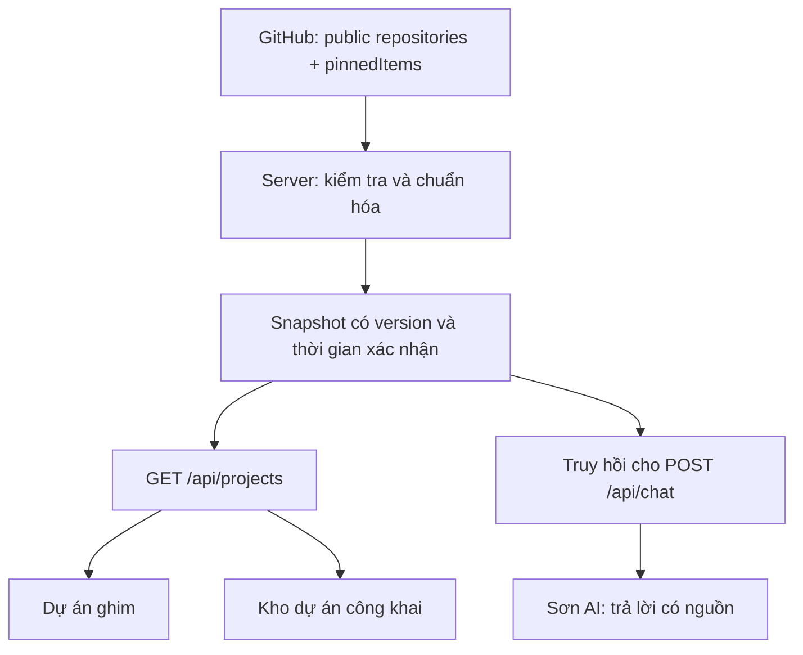

# Đề xuất đồng bộ GitHub, portfolio và Sơn AI

Ngày khảo sát: 30/10/2026. Phần dưới là bản khảo sát ban đầu trên nền production 35e3aa1; endpoint chatbot chuẩn là /api/portfolio-assistant. Cập nhật triển khai: mục nổi bật đã chuyển sang `/api/pinned-projects`, đọc trực tiếp phần ghim công khai của GitHub, kiểm tra khoảng mỗi phút với cache và bản lưu có thời gian xác nhận. Không cần GitHub token. Đồng bộ kiến thức chatbot với nguồn chung vẫn là đề xuất; các mô tả bốn dự án cố định dưới đây là hiện trạng trước thay đổi này.

## Nguyên nhân trong code hiện tại

| Khu vực | Nguồn hiện tại | Vì sao lệch với GitHub |
| --- | --- | --- |
| Dự án nổi bật | `src/content/portfolio-data.ts`, qua `selected-work-section.tsx` | Bốn dự án cố định; không đọc danh sách ghim. |
| Kho dự án công khai | `use-public-github-repositories.ts` → GitHub REST `/users/JasonTM17/repos` | Có cập nhật khi tải trang, quay lại tab và mỗi 5 phút khi tab hiển thị. Danh sách repo công khai không chứa lựa chọn ghim của chủ hồ sơ. |
| Sơn AI | `api/chat.mjs` → `portfolio-assistant-rag.mjs` → `portfolio-assistant-knowledge.mjs` | Bộ kiến thức gồm 19 dự án viết sẵn; truy hồi không gọi GitHub. Repo mới, thay đổi mô tả hay thay đổi ghim không tự đi vào câu trả lời. |

Danh sách công khai có phân trang, cache trình duyệt và dữ liệu dự phòng. Đây là cơ chế đã có, cần giữ hoặc chuyển sang nguồn chung. Không nên chỉ thêm tên dự án mới vào kiến thức tĩnh: thao tác đó vẫn phải làm lại mỗi lần GitHub thay đổi.

Website production trả HTTP 200 tại thời điểm khảo sát. Bundle công khai `/assets/index-93hglA3k.js` chứa endpoint repo, chu kỳ 300 giây và khoảng nghỉ 120 giây; cache key của bản deploy là `nguyen-son-public-repositories-v2`, khác `v1` trong checkout. Vì vậy đã có cơ chế archive live trên production, nhưng không thể coi checkout là bản sao chính xác toàn bộ deployment. Quan sát bundle phía khách không chứng minh phiên bản function `/api/chat`, cấu hình Vercel hay khả năng trả lời của model. Chưa chạy hội thoại model thật trong khảo sát này.

Hồ sơ GitHub công khai tại thời điểm đối chiếu ghim sáu repo: `App_AI_powered_waste_sorting`, `Ecommerce_BookStore`, `JobHunter_SpringBoot_RestfulAPI_React`, `Laptopshop_Spring_Boot_MVC`, `HealthCare_Project`, `Student_Management_UTE`. Nhóm này khác bốn selected-work cố định trong source. Đây là ảnh chụp trạng thái hiện tại, không phải danh sách nên hardcode tiếp. [Hồ sơ GitHub của Sơn](https://github.com/JasonTM17).

## Phương án đề xuất

Tạo **một bộ dữ liệu GitHub do server quản lý**, dùng chung cho trang nổi bật, kho dự án và chatbot.

`api/github-projects.mjs` là module dự kiến quản lý việc lấy dữ liệu, thời hạn cache và chuẩn hóa. `api/projects.mjs` cung cấp dữ liệu công khai. `/api/chat` gọi trực tiếp module dùng chung; không nhận kiến thức dự án do trình duyệt tự gửi lên.

Snapshot đề xuất gồm `version`, `verifiedAt`, `status`, `pinnedRepositoryIds`, `repositories` và trạng thái xác nhận riêng của danh sách ghim. Mỗi repo lưu ID ổn định, tên, URL chính chủ, mô tả, ngôn ngữ, topics, thời gian cập nhật và URL README. Chỉ các trường công khai nằm trong danh sách cho phép được xuất ra trình duyệt.

### Lấy đúng dự án ghim

Dùng GitHub GraphQL `user(login: "JasonTM17") { pinnedItems(first: 6, types: REPOSITORY) { nodes { ... on Repository { id nameWithOwner url description isPrivate } } } }`. `pinnedItems` là trường dành cho nội dung chủ hồ sơ đã ghim; giữ thứ tự server trả về và kiểm chứng bằng hồ sơ thật trong nghiệm thu.

Nguồn chính thức: [GitHub GraphQL User / pinnedItems](https://docs.github.com/en/graphql/reference/users#user). GraphQL yêu cầu xác thực: [Forming calls with GraphQL](https://docs.github.com/en/graphql/guides/forming-calls-with-graphql).

- Credential chỉ ở server Vercel, không dùng biến `VITE_`; quyền đọc tối thiểu phù hợp loại credential và chỉ yêu cầu dữ liệu công khai cần thiết.
- Lọc repo private, kiểm tra URL và chủ sở hữu. Đề xuất mặc định giữ phạm vi repo chính chủ; repo bên ngoài được ghim cần quyết định phạm vi riêng trước triển khai.
- Nếu danh sách ghim trả về rỗng hợp lệ: hiển thị trạng thái chưa ghim hoặc khu vực biên tập được ghi nhãn rõ. Không coi kết quả rỗng là lỗi mạng.
- Nếu truy vấn ghim lỗi: giữ snapshot ghim đã xác nhận và báo thời điểm cũ; không tự thay bằng repo mới cập nhật rồi gắn nhãn “đã ghim”.

### Độ mới có thể cam kết

Đề xuất giai đoạn đầu là **gần thời gian thực, mục tiêu 1–2 phút khi đang sử dụng**, không cam kết tức thì:

- Mỗi request web/chat dùng snapshot còn hạn tối đa 60 giây. Khi hết hạn, server làm mới với timeout và gộp request trùng trong cùng tiến trình.
- Web kiểm tra lại mỗi 60 giây khi tab hiển thị, khi quay lại tab và có nút “Làm mới”. Dùng ETag/version để tránh tải lại dữ liệu không đổi.
- Chat kiểm tra độ mới trước truy hồi; câu trả lời gắn thời gian dữ liệu và version đã thực sự sử dụng. Nếu GitHub lỗi, nói rõ đang dùng dữ liệu cũ.
- Khi tab bị ẩn hoặc GitHub lỗi/rate limit, độ trễ có thể vượt mục tiêu; UI phải thể hiện điều đó.

Mục tiêu này áp dụng cho dữ liệu cơ bản và danh sách ghim trong điều kiện upstream bình thường. README chi tiết có thể có chu kỳ làm mới riêng và phải ghi thời gian riêng. Cache RAM của Vercel chỉ là tối ưu theo instance, không phải bộ nhớ bền vững hay cơ chế khóa toàn hệ thống. Muốn lưu bản hợp lệ qua cold start cần kho cache bền vững được chọn trước triển khai. Không thêm cron hoặc cơ sở dữ liệu chỉ để tạo cảm giác “realtime”.

Webhook `push`/`repository` có thể giảm độ trễ cho nội dung repo ở giai đoạn sau. Danh mục webhook hiện được công bố không liệt kê sự kiện riêng cho thay đổi ghim hồ sơ; vì vậy đề xuất vẫn dùng polling cho ghim, không phụ thuộc vào một webhook chưa được xác nhận. [GitHub webhook events](https://docs.github.com/en/webhooks/webhook-events-and-payloads).

### Kiến thức chatbot đầy đủ và trung thực

1. Tạo tài liệu truy hồi từ **toàn bộ snapshot**, ưu tiên khớp tên repo, tên hiển thị và công nghệ; thêm trường xác nhận “đang ghim”. Câu hỏi đếm/liệt kê cần dữ liệu tổng hợp, không chỉ top 5 đoạn văn.
2. Giữ profile được chủ portfolio duyệt ở lớp riêng. Mô tả biên tập EN/VI có thể giữ lại theo repository ID, nhưng không được ghi đè trạng thái công khai, ghim hoặc thời gian xác nhận từ GitHub.
3. Giai đoạn đầu dùng metadata. Giai đoạn sau mới đọc README của repo liên quan với giới hạn kích thước, timeout, cache và commit/version. Tách nội dung tài liệu khỏi chỉ dẫn model để giảm rủi ro prompt injection.
4. Mỗi câu trả lời trả nguồn dạng `{title, url, verifiedAt}`; UI hiển thị link GitHub bấm được. Không suy từ README rằng một hệ thống đang chạy production, vượt kiểm thử hay đã deploy.
5. Snapshot thiếu thông tin thì trả lời chưa đủ dữ liệu. Khi GitHub lỗi hoàn toàn và chưa có cache xác nhận, dùng nội dung biên tập được ghi nhãn hoặc báo chưa xác nhận; không trình bày như dữ liệu mới.

### Trạng thái lỗi và dữ liệu dự phòng

- Phân biệt đang tải, mới xác nhận, cache cũ và chưa có dữ liệu. Dùng `verifiedAt` từ server; không gắn thời gian mới khi chỉ đọc cache.
- Snapshot chỉ được thay khi các phần tương ứng đã xác thực xong; một trang phân trang lỗi không trở thành danh sách đầy đủ mới. Pin có thể tham chiếu repo chưa có trong trang REST nên cần hợp nhất bằng ID.
- Có thời hạn tối đa cho dữ liệu cũ; loại bỏ repo không còn public ngay sau lần xác nhận thành công. Không hứa thu hồi tức thì khi GitHub đang mất kết nối. Trước khi thêm README cache cần chốt chính sách hết hạn/xóa riêng.
- Backoff theo lỗi/rate limit, không để từng khách truy cập gọi GitHub liên tục. Endpoint công khai không chấp nhận URL upstream tùy ý.

## Thứ tự triển khai đề nghị

| Giai đoạn | Đầu ra | Điều kiện hoàn tất |
| --- | --- | --- |
| 1. Nguồn chung | Module server, public endpoint, cache, credential server | Phân trang đầy đủ, pin đúng, không lộ token, có stale/error state. |
| 2. Web | Dự án nổi bật theo ghim; archive dùng cùng endpoint | Ghim/bỏ ghim/thay mô tả hiện lên trong mục tiêu 1–2 phút ở tab đang xem; EN/VI và mobile đúng. |
| 3. Sơn AI | Truy hồi động, tổng hợp số lượng, nguồn có link và thời gian | Hỏi về repo mới/đang ghim trả đúng dữ liệu cùng snapshot với web. |
| 4. Kiểm chứng và phát hành | Test lỗi, preview Vercel, kiểm tra provider thật | Đủ bằng chứng trước production; có deployment cũ để rollback. |

Các kiểm tra cần có khi thực hiện: fixture pin thay đổi thứ tự và rỗng; repo mới, đổi tên, bị xóa/chuyển private; lỗi một trang REST; GraphQL trả HTTP 200 nhưng có `errors`; GitHub 403/429/timeout; cold start không cache; câu hỏi tiếng Việt không dấu, tên repo chính xác, đếm/liệt kê; nội dung README có chỉ dẫn độc hại; secret không nằm trong bundle. Dùng clock giả cho TTL/polling, không chờ thật trong unit test.

Checkpoint dự kiến: `npm run build`, `npm run test`, `node --test api/*.test.mjs`, rồi `npm run test:e2e` với mock GitHub. Chỉ sau đó kiểm chứng preview với GitHub thật và một hội thoại DeepSeek được cấu hình; các kiểm tra local không thay thế hai bằng chứng này.

## Cải thiện giao diện được làm trong lượt này

Nút mở Sơn AI được thiết kế theo ảnh người dùng: nền navy, robot xanh ngọc có chi tiết vàng, tên và mô tả hai dòng. Desktop hiển thị nhãn; mobile thu gọn còn biểu tượng và mở nhãn khi focus/mở chat. Không hiển thị huy hiệu “online” hay “live” khi chưa có bằng chứng runtime.

Theo yêu cầu mở rộng, giao diện toàn trang cũng được chỉnh: tiêu đề dễ đọc hơn, thẻ nổi bật có minh họa concept, kho dự án có tìm kiếm, phần nguyên tắc nền sage và footer navy. Nội dung EN/VI, GitHub feed và tương tác studio được giữ nguyên về chức năng.

Phần triển khai đồng bộ vẫn là đề xuất. Chưa thay backend, thêm credential, commit, push hoặc deploy production trong phạm vi này.
